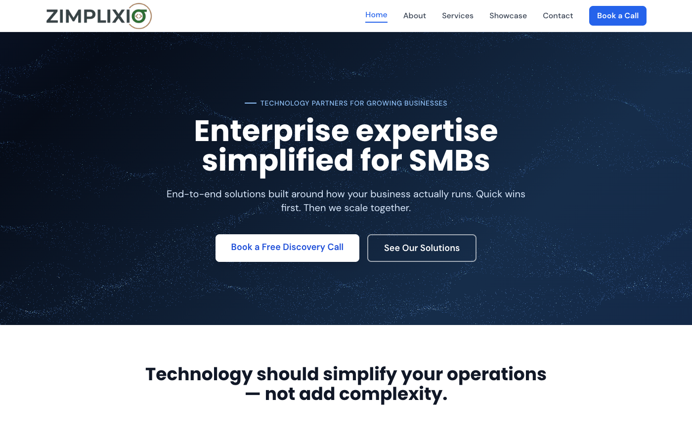
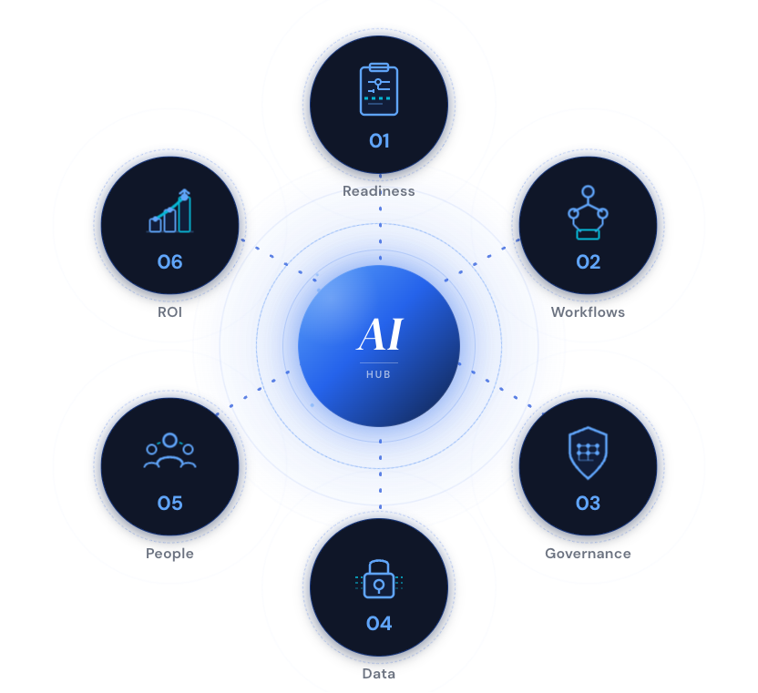
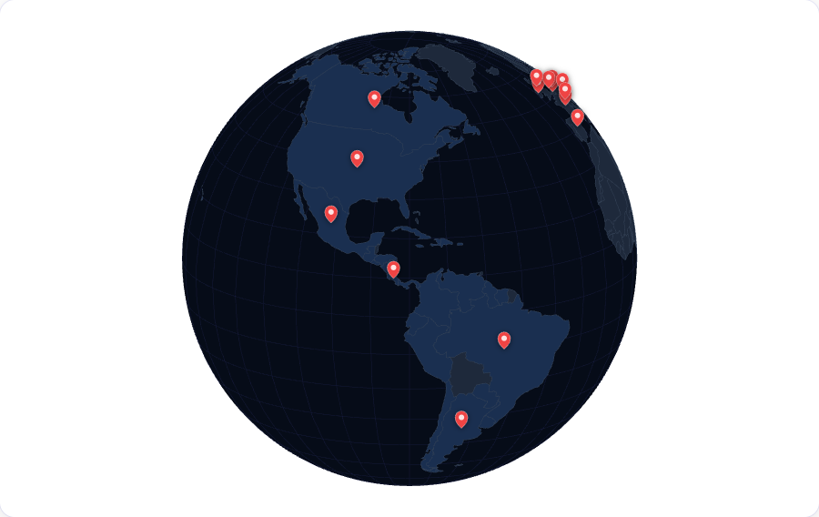
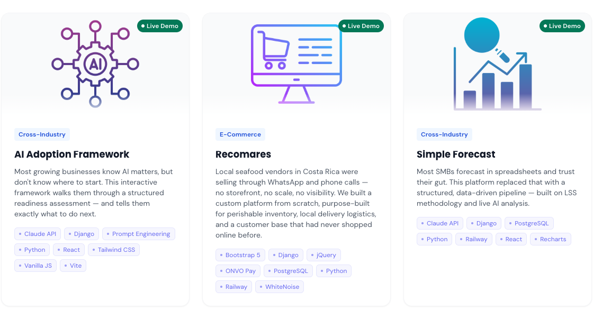

# Zimplixio

The official website for **Zimplixio**, an SMB technology consulting firm — a marketing site that doubles as a live showcase of client work. It serves an interactive solution gallery with embedded demos, an AI readiness assessment backed by Claude, a discovery-call booking system, and a contact pipeline hardened against a sustained bot campaign.

**Live:** [zimplixio.com](https://zimplixio.com)


---



<table>
<tr>
<td width="50%"></td>
<td width="50%"></td>
</tr>
<tr>
<td><b>AI Adoption Framework</b> — React Flow hub-and-spoke navigator over six methodology stages, paired with an 8-question readiness assessment.</td>
<td><b>About page globe</b> — D3 orthographic projection with a three-state machine: globe → flat → US bounding-box zoom.</td>
</tr>
</table>



---

## What's here

- **Solution showcase** — case studies with live cross-origin iframe demos and system-design toggles, driven by a carousel that falls back to a static row when every card already fits
- **AI Adoption Framework** — React Flow diagram plus an assessment wizard that calls Claude and returns a structured JSON report
- **Booking system** — three-step wizard that detects the visitor's timezone and converts Eastern slot times for display, with a four-stage email lifecycle
- **Contact pipeline** — layered spam filtering, acknowledgement email, admin review tooling
- **Hero animation** — 20,000 particles across six twisted ribbon surfaces, written as raw canvas `ImageData` with no WebGL and no library
- **Services page** — scroll-pinned horizontal panels on desktop, a tabbed layout on mobile, sharing one template

---

## Tech Stack

| Layer | Technology |
|-------|------------|
| Backend | Django 6.0.4, Python 3.14 |
| Database | PostgreSQL (persistent connections, same-region) |
| Frontend | Tailwind CSS (CDN), AOS animations, vanilla-JS canvas |
| React bundle | React 19, Vite, `@xyflow/react` v12 |
| AI | Anthropic Claude (`claude-sonnet-4-6`) |
| Media storage | Cloudflare R2 (via django-storages) |
| Static files | WhiteNoise (`CompressedStaticFilesStorage`) |
| Edge | Cloudflare proxy in front of Railway |
| Email | Microsoft 365 SMTP, SPF + DKIM authenticated |
| Deployment | Railway (Gunicorn, 2 workers) |

---

## Engineering Notes

The decisions in this project that took the most thought, and what each one cost.

### Template inheritance instead of conditionals

Showcase detail pages vary per project. The obvious approach — `` branches in a shared template — rots quickly into a pile of special cases.

Instead, `detail-base.html` is the single structural source of truth with `` tags and generic defaults, and per-project templates extend it and override only what they need. `ShowcaseDetailView.get_template_names()` maps slug → template, falling back to the base, so an unknown project still renders sensibly.

The rule is enforced rather than documented: a test scans `detail-base.html` and fails the build if a slug conditional appears.

### A 10–16× latency improvement, measured

Pages were taking 793–1074 ms. Two independent database causes, found by measurement rather than inspection:

1. `CONN_MAX_AGE` was unset, so Django rebuilt a PostgreSQL connection on every request — ~800 ms each.
2. The Railway web service sat in US East while Postgres was in EU West, so every query crossed the Atlantic at ~85 ms per round trip.

Result: **793–1074 ms → 60–115 ms**, with database-attributable overhead now inside measurement noise.

The method mattered more than the fix. Comparing a DB-touching endpoint against one that skips the ORM isolated connection cost from query cost from template cost. Four plausible culprits were measured and ruled out along the way — the Tailwind CDN, AOS blocking render, Railway cold starts, and the public database proxy. All four would have been reasonable guesses; none was the cause.

### Layered spam defence, and the decision not to add a CAPTCHA

The contact form was taking a sustained automated campaign — thousands of submissions, every one triggering an acknowledgement email to a scraped third-party address. That volume got the sending mailbox restricted by Microsoft.

The filter combines a decoy field with a signed, tamper-proof render timestamp, and treats the two signals **asymmetrically**:

| Signal | Outcome | Why |
|---|---|---|
| Submitted in under 3 seconds | **Refused** — no row written | No human fills this form that fast |
| Decoy field filled | **Flagged** — stored, never emailed | Browser autofill can trip it |
| Token missing or expired | **Flagged** — stored, never emailed | Can just mean a tab left open overnight |

Two details carry most of the value. The order of checks is load-bearing: conclusive signals are evaluated first, because the first match decides refuse-versus-store, and checking the decoy first meant a bot tripping both got stored. And a refused visitor can simply press Send again — the re-rendered form echoes the original token, which has by then aged past the floor — so a false positive is recoverable rather than silent.

Measured outcomes: two distinct bots, each caught by a different signal; Cloudflare's Bot Fight Mode caught **0%** of the high-volume one; and Turnstile was designed, costed and **deliberately not deployed**, because it would introduce new ways to lose a genuine lead for no measured gain.

### Design-system rules as tests, not documentation

A documented rule is advisory and only works if read. Several of this project's UI constraints are mechanically checkable, so they're static-analysis tests over every template instead:

- No ambient blur circles inside an animated hero — scoped to the hero `<section>` by nesting depth, so the legitimate ones elsewhere don't trip it
- No `dark:` variants (the site is light-only; nothing sets the class, so they'd be dead code)
- No per-project conditionals in the shared showcase template

Each test was verified by deliberately introducing the violation it guards against and confirming it fails with the file and line.

### Accepted trade-offs

Two shortcuts were taken knowingly and are documented rather than quietly carried:

- **Tailwind via CDN in production.** It is a runtime compiler, not a stylesheet — it compiles CSS in the browser on every page load, which is why the CSP needs `unsafe-eval`. Migrating it to a build step is open work and is now the largest remaining component of perceived load time.
- **Non-manifest static storage.** WhiteNoise runs `CompressedStaticFilesStorage`, so filenames are not content-hashed and a file's URL never changes when its bytes do. Renaming the file is the only reliable cache bust. Restoring the manifest backend risks breaking `collectstatic`, so it stays until that is verified.

A hand-written CSP middleware derives its `img-src` entry from the configured R2 domain rather than hardcoding it, so rotating the bucket cannot silently block every image on the site.

Fuller detail on all of the above — including the failure modes behind each rule — is in [`docs/GOTCHAS.md`](docs/GOTCHAS.md).

---

## Testing

```bash
cd Zimplixio_site
python manage.py test                              # 99 tests
python manage.py test pages                        # single app
python manage.py test pages.tests.ContactFormTests # single class
```

Coverage is behavioural rather than line-count driven — page responses, form validation, the spam filter's refuse/flag/accept paths, email rendering including the plain-text alternative, admin bulk actions, and a management command. Alongside those sit static-analysis tests that read every template and fail on design-system violations.

| App | Tests |
|---|---|
| `pages` | 57 |
| `framework` | 17 |
| `showcase` | 16 |
| `metrics` | 5 |
| `booking` | 4 |

---

## Known Gaps

Stated plainly rather than discovered later:

- **No CI pipeline.** Tests run locally; nothing gates a push.
- **Uneven coverage.** `booking` is the most stateful app and has the thinnest tests; `core`'s CSP middleware has none.
- **Double-booking is possible.** Available slots are filtered at read time, but no database constraint prevents two pending requests for the same slot from both being confirmed. Known, deferred to the next scheduling pass.
- **Tailwind CDN in production**, as described above.

---

## Application Flows

### Booking

1. Visitor submits at `/book/` → acknowledgement email to the visitor, notification to `LEAD_NOTIFICATION_EMAIL`
2. Admin reviews at `/zm-admin/booking/bookingrequest/`
3. Admin sets status to `Confirmed` → confirmation email with the Zoom link

Availability comes solely from `TimeSlot` records in the admin. There is no external calendar sync.

### Contact

| Outcome | Row stored | Email sent | Cause |
|---------|-----------|------------|-------|
| **Accepted** | Yes, `is_spam=False` | Acknowledgement | Looks human |
| **Flagged** | Yes, `is_spam=True` | None | Decoy filled, or missing/expired token |
| **Refused** | No | None | Submitted in under 3 seconds |

Unlike booking, no admin notification email is sent — deliberate. To classify rows predating the filter:

```bash
python manage.py flag_contact_spam            # dry run, reports only
python manage.py flag_contact_spam --apply    # writes
```

---

## Getting Started

### Prerequisites

Python 3.14 · Pipenv · PostgreSQL · Node.js (only to rebuild the React bundle)

### Setup

```bash
git clone <repo-url> && cd Zimplixio

export PIPENV_VENV_IN_PROJECT=1
pipenv --python /path/to/python3.14 install
pipenv shell

# create Zimplixio_site/.env — see Environment Variables below

cd Zimplixio_site
python manage.py migrate
python manage.py createsuperuser
python manage.py runserver
```

Site at `http://localhost:8000`, admin at `/zm-admin/`.

> **Email in dev** uses the console backend, printing messages to the terminal. No SMTP setup needed locally.

### Rebuilding the React bundle

```bash
cd frontend && npm install && npm run build
```

Output lands in `Zimplixio_site/static/dist/` (gitignored) and is served by Django.

---

## Project Structure

Standard Django layout. The parts that aren't obvious:

```
docs/GOTCHAS.md             Implementation traps and the reasoning behind each rule
frontend/src/data/          stages.ts and questions.ts — canonical content for the
                            React diagram and assessment wizard
Zimplixio_site/
  templates/                Project-level only; no per-app template dirs
  core/                     Context processors, CSP middleware, sitemaps
  showcase/                 Gallery and detail pages — also serves the framework page
  framework/                API endpoints only, no page views
  static/dist/              React build output (gitignored; run npm run build)
```

---

## Environment Variables

Create `Zimplixio_site/.env`. On Railway these are set in the dashboard instead.

### Core

| Variable | Dev value | Description |
|----------|-----------|-------------|
| `DJANGO_SETTINGS_MODULE` | `Zimplixio_site.settings.dev` | `settings.prod` on Railway |
| `SECRET_KEY` | any string | Generate a long random key for production |
| `DEBUG` | `True` | Always `False` in production |
| `ALLOWED_HOSTS` | `localhost,127.0.0.1` | Comma-separated |
| `DATABASE_URL` | `postgres://...` | PostgreSQL connection string |
| `CONN_MAX_AGE` | `600` | Load-bearing for response time — see Engineering Notes |

These five have no defaults; the app will not boot without them.

### Email (Microsoft 365)

| Variable | Value | Description |
|----------|-------|-------------|
| `EMAIL_BACKEND` | console (dev) / smtp (prod) | Console prints to terminal |
| `EMAIL_HOST` | `smtp.office365.com` | |
| `EMAIL_PORT` | `587` | STARTTLS |
| `EMAIL_USE_TLS` | `True` | Required for Microsoft 365 |
| `EMAIL_HOST_USER` | `team@zimplixio.com` | Sending mailbox |
| `EMAIL_HOST_PASSWORD` | *(mailbox password)* | |
| `DEFAULT_FROM_EMAIL` | `team@zimplixio.com` | |

> **Sending mail needs correct DNS, not just these variables.** The domain must publish an SPF record including `spf.protection.outlook.com` and two DKIM CNAMEs, or DMARC tells receiving servers to junk everything. Mail CNAMEs in Cloudflare must be **DNS only**, never proxied. **Do not enable MFA on the sending mailbox** — it authenticates with basic auth, and MFA silently breaks every outbound email. See [`docs/GOTCHAS.md`](docs/GOTCHAS.md) → Outbound Email & Deliverability.

### Business settings

| Variable | Description |
|----------|-------------|
| `LEAD_NOTIFICATION_EMAIL` | Receives booking and assessment-lead notifications |
| `ZOOM_MEETING_URL` | Link embedded in booking confirmation emails |
| `SITE_URL` | Base URL for absolute links in emails |
| `ANTHROPIC_API_KEY` | Enables the AI assessment — the endpoint returns 503 without it |

`BOOKING_TIMEZONE` is hardcoded in `settings/base.py`, not an environment variable.

### Cloudflare R2

`R2_ACCESS_KEY_ID` · `R2_SECRET_ACCESS_KEY` · `R2_BUCKET_NAME` · `R2_ENDPOINT_URL` · `R2_PUBLIC_DOMAIN`

Production only, no defaults — a missing value raises `ImproperlyConfigured` at startup rather than failing quietly.

---

## Deployment

Railway, configured via `railway.toml` and `start.sh`:

```
build:  cd frontend && npm install && npm run build
start:  collectstatic → migrate → gunicorn (2 workers)
```

The Postgres service must stay in the **same region** as the web service — see Engineering Notes.

---

## Admin

At `/zm-admin/`, not the default path.

| Section | Purpose |
|---------|---------|
| Showcase | Case study projects, media, tech tags |
| Booking → TimeSlots | Weekly availability windows |
| Booking → BookingRequests | Review and confirm requests |
| Metrics | Active NPS score |
| Contact | Review submissions, filter spam, bulk actions |
| Framework → AssessmentLeads | Assessment leads with readiness levels |

---

## License

Private — all rights reserved. © Zimplixio.

The repository is published for portfolio and reference purposes; the code is not licensed for reuse.
